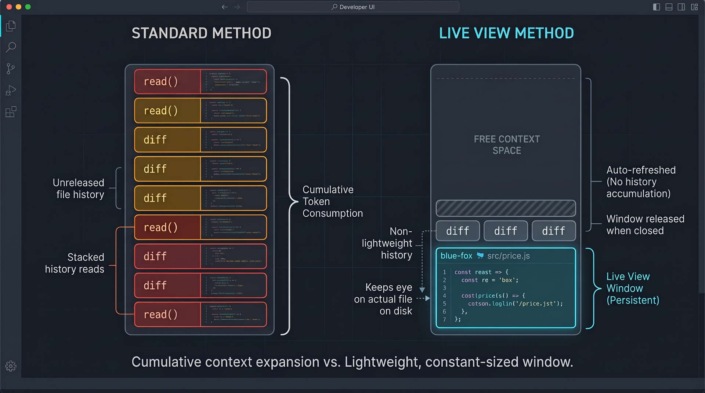

# liveview



A [pi](https://github.com/earendil-works/pi) coding-agent extension that gives the model a **live view** of the files it is working on.

Instead of `read()` burning a file snapshot permanently into the conversation, `open()` keeps a *window* on the file. The contents of every open window are re-read from disk before each request and appended to a `LIVE VIEW` block at the end of the prompt, so the model always sees the file as it is now — no rebuilding state from an old read plus edit diffs. `close()` releases the window and its context.

### constant current state

The immediate benefit is that models do not have to reconstruct the current state of a file from original state + diffs.  This should immediately reduce the 'mental math' required of the model.  

In addition, the close() command allows a model to release file contents from its context.  There are two behaviors this makes possible that can greatly enhance what a model can do.  

### search and dismiss

The first is search without context burn.  Normally when a model opens a file looking for something that file is held in context until a compaction event.  open() and close() allow a model to look at a file, decide it doesn't have what is needed, and close it again without burning context.  A model could search through more information than what fits in its context window.  

The tool calls themselves stay in session so the model can see open(file A), any thoughts or notes it may have had, and close(file A).  But it doesn't need to see the actual file anymore.  

### inspect, narrow, focus

A large file can be opened and read in its entirety.  Then the model can determine the important parts of the file to look at, close the full file, and only open narrow focused windows on the parts that it is referencing.  

### close on completion

The second possible benefit would be close on completion.  If a model has finished writing boilerplate files for example, they can be closed and their context freed for other work.  

These two behaviors could enable a model to accomplish much more work between compaction events than is normally possible.  

Again, the tool calls still live in session so the model knows it opened, edited, and closed the file.  

Design rationale is in [`design.md`](./design.md); the implementation is a single file, [index.ts](extensions/liveview/index.ts)


There is a cost associated with this.  The uncached input tokens jumps because the live-view is fresh on every request.  if you have a provider that discounts cached input tokens this could cost 2-4x as much.   

There is a genuine context savings because the 'read' of source files is only paid for once in the final context, or its free if the model closes a file it's done with.  So it does enable a model to work more than its context window would normally allow.  


## Run it

Drop the liveview extension folder in .pi/extensions if you want it project local:  

    project_folder/.pi/extensions/liveview/index.ts

No skill file is needed — everything the model must know is in the `open`/`close` tool descriptions and their `promptGuidelines`, which are in context whenever the extension is loaded.

# Tools

### `open(path, offset, limit)`

Opens a new window, or re-ranges an existing one. Same parameter shape and same limits as `read()`: 1-based `offset`, `limit` in lines, 2000 lines or 50KB, whichever comes first.

```
open("src/price.js", 10, 40)   -> open successful - live-view window blue-fox
open("blue-fox", 500, 50)      -> re-ranges blue-fox in place, keeping its id
```

* Returns a **confirmation only** — window id and the range now shown, never file contents. The contents are already in context when the model reads that confirmation: the block is built at the request boundary, so it lands directly after the tool result in the same request.
* A different range of the same file is a **new window with a new id**. Window ids are non-ordered color-noun handles (e.g. `blue-fox`).
* Multiple windows per file are allowed. Re-ranging requires the window id.
* Plain text files only; a file containing a NUL byte is rejected.

### `close(windowId | path)`

`close("blue-fox")` closes window `blue-fox`. `close("src/price.js")` closes all open windows for that file. Reports how many tokens it freed.

## The live-view block

Built fresh and appended as a trailing `system` message to every request that has at least one window open. It is never written into the session, so it does not appear in the transcript or the TUI.

```
<<<<LIVE VIEW>>>>
Contents below were re-read from disk before this request. Each window is the file
as it is NOW: use it in place of any earlier read of that file in this conversation,
and in place of rebuilding it from edit diffs.

3 windows · 2070 lines shown · this block is 62% of the space left in this context
  blue-fox      src/price.js   lines 10-39 of 2400
  amber-otter   src/price.js   lines 500-549 of 2400
  slate-badger  src/parse.js   lines 1-1620 of 4300

<<< blue-fox  src/price.js  lines 10-39 of 2400 >>>
import { RATE } from "./constants";
...
<<</blue-fox>>>

<<<<END LIVE VIEW>>>>
```

Window contents are raw text with **no per-line number prefixes**; trailing and repeated whitespace in the block are byte-exact, so exact-match search/replace can be copied straight out of the block without prefix, indentation, or whitespace mismatch. The hunk header carries the range.

## Context budget

pi cannot see the block, so its own compaction checks would not fire in time — the extension does the accounting (`estimateTokens` from pi, `ctx.getContextUsage()` for the conversation).

With `reserveTokens` from pi's compaction settings (16384 by default) and `working = contextWindow - reserveTokens`:

| Rule                      | Threshold                                                                                                                             |
| ------------------------- | ------------------------------------------------------------------------------------------------------------------------------------- |
| Max live view             | `working * 2/3` — `open()` fails above it                                                                                             |
| Compaction triggers       | `contextTokens + blockTokens + reserveTokens > contextWindow`, or `working - contextTokens < 20k` while the block itself is under 20k |
| Minimum live-view reserve | `LIVE_RESERVE_TOKENS = 20k`, enforced while `working ≥ 40k` (small contexts fall back to the overflow rule)                           |

Compaction is requested from `agent_settled`, once the run has settled. It is deliberately not requested from the `context` handler: `ctx.compact()` is pi's manual compaction entry point, which aborts the agent operation it is called during and never resumes that turn.

Rejected `open()` calls explain the sizes involved and provide a ranked list of open windows sorted by token weight, recommending the best candidates to `close()` or shrink (`open(windowId, offset, limit)`). A compaction guard prevents a second summariser call stacking on top of one already running. If the block alone exceeds the cap, windows are truncated and the header says so — shrinking is the only lever left, since compacting the conversation cannot help.

The live view is never allowed to be the thing that starves: 20k tokens of the working space are reserved for it (where the context is big enough to afford it), so a block too small to show the problem cannot leave the model working blind until the conversation happens to overflow. Once a turn settles, an over-large conversation is compacted to give that reserve back.

Every `open()` / `close()` result reports the window's token cost and the live view's share of the working context.

## Known limits

* Window state lives in memory only — `/resume`, `/tree` and forks drop open windows silently.
* The block is re-prefilled every request, so on large local contexts (this is aimed at qwen3.8:27b / qwen3.8-flash-next with 128k+) prefill time per turn is a real cost, not only token count.
* Standard compaction summarises away earlier reads while windows keep refreshing; the first block after a compaction boundary carries a one-line marker saying an earlier read may have been summarised away.
* Not implemented yet, by design: stripping earlier `read()` results for opened files, a custom compaction routine, and any mechanism that forces the model to use `open()` over `read()`.

## Costs and penalties

The live-view block is dynamic and regenerated at each request so it is never cached.  It is at the tail of the session, so the session itself is cached, but for online providers this will increase the costs significantly.  

This extension is targeted at local inference where this is less of an issue.  


## Initial test results

There seems to be no significant logical load on the model when using the extension.  

After some tweaking, models seem to find the window easy to work with and trust the current state.  

[Here](live-view-v2-test1.html) is a exported session of qwen3.8-flash-next working through an hardware problem with an admittedly small file.  It ran for over 30 turns, editing and testing things.  

It did not need to re-read the file at all, and the file itself consumed less than 2% of the context, and never grew.  It did not spend any time or effort second guessing the mechanics of the extension.  

More testing is needed, but it seems that the three primary goals are actually working.  

- The models don't need to reconstruct current state from read() plus diffs.  
- There isn't any significant reasoning overhead.  
- It does reduce context use as intended.  
